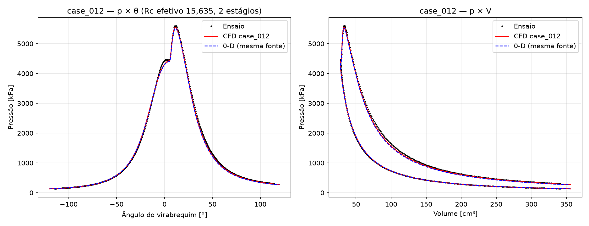
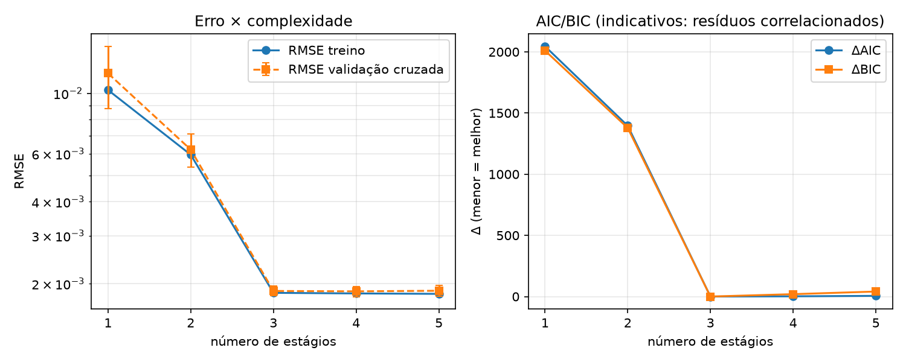
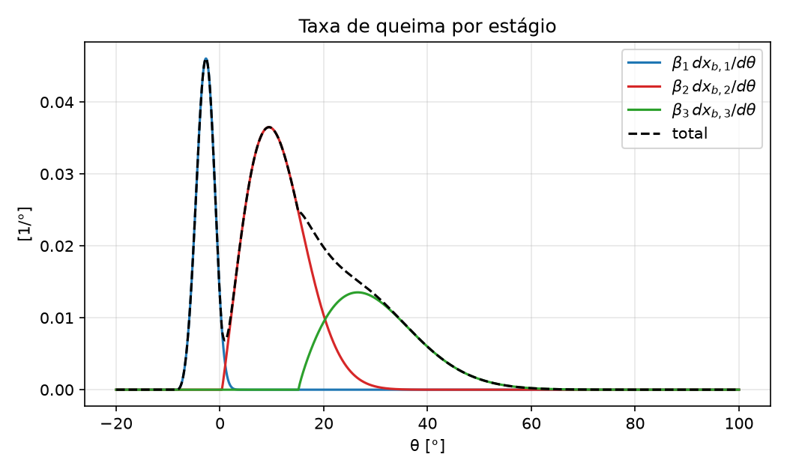

# wiebepy — Wiebe functions with 1 to 5 stages

🌐 [Português](README.md) · **English**

Scientific Python tool to model, evaluate, fit and compare **single, double,
triple, 4- and 5-stage** Wiebe functions: mass fraction burned
$x_b(\theta)$, burn rate $dx_b/d\theta$ (analytical derivative), fitting to
experimental data by PSO with local refinement, multiple runs with
statistics, objective comparison across stage counts (AIC/BIC + blocked
cross-validation), identifiability diagnostics, and serial, parallel-CPU or
NVIDIA-GPU execution.

The **core** works only with the Wiebe function and with data
$(\theta, x_b)$ and/or $(\theta, dx_b/d\theta)$, without any thermodynamic
model. Two **optional** modules extend it without changing the core:

- **pressure mode** (0-D): fits N stages to the cylinder pressure curve with
  a single-zone model (Hohenberg) — §"Pressure mode" below;
- **CFD** (OpenFOAM 13): compressible flow with the heat release prescribed
  by the calibrated Wiebe function — §"CFD" below.

> 📖 Step-by-step guide: open [`Help.html`](Help.html) in the browser (it has
> its own Portuguese/English switch).
> Command-line help: `wiebepy --lang en --help`,
> `wiebepy --lang en --help-model`, `wiebepy --lang en --help-examples`.

## Contents

1. [Installation](#1-installation)
2. [Mathematical formulation](#2-mathematical-formulation)
3. [Parameters](#3-parameters)
4. [Command line](#4-command-line)
5. [Python API](#5-python-api) · [Graphical interface](#graphical-interface)
6. [Optimization](#6-optimization)
7. [Comparison across stage counts](#7-comparison-across-stage-counts)
8. [Parallel and GPU execution](#8-parallel-and-gpu-execution)
9. [Input and output formats](#9-input-and-output-formats)
10. [Validation and tests](#10-validation-and-tests)
11. [Benchmark](#11-benchmark)
12. [Project structure](#12-project-structure)
13. [Known limitations](#13-known-limitations)
14. [References](#14-references)

---

## 1. Installation

Requires Python ≥ 3.11 (Windows, Linux or WSL2).

```bash
git clone <repository-url> wiebepy
cd wiebepy
python -m venv .venv
# Windows:            .venv\Scripts\activate
# Linux/macOS/WSL2:   source .venv/bin/activate
python -m pip install --upgrade pip
pip install -e ".[numba,gui,dev]"     # core + Numba + interface + pytest
```

Optional extras — the program works **without any of them**:

| Extra | Installs | For |
|---|---|---|
| `numba` | `numba` | compiled CPU kernels (the fastest backend on the CPU) |
| `gpu` | `cupy-cuda12x` | NVIDIA GPU (requires a CUDA 12+ driver) |
| `gui` | `streamlit`, `altair`, `pandas` | graphical interface (`wiebepy --gui`) |
| `cfd` | dependencies of the CFD module | `wiebepy cfd` subcommand (the OpenFOAM 13 solver on WSL2 is installed separately; see `docs/cfd/install.md`) |
| `dev` | `pytest` | tests |

Without installing the package, use `python main.py` instead of `wiebepy`.
Alternative: `pip install -r requirements.txt`.

Quick check:

```bash
wiebepy --devices          # hardware, Numba, CuPy/GPU and available backends
wiebepy --stages 3 --plot  # evaluates and plots a default triple-Wiebe
python -m pytest           # test suite
```

## 2. Mathematical formulation

### Single-Wiebe

$$
x_b(\theta) =
\begin{cases}
0, & \theta < \theta_0 \\[2pt]
1 - \exp\left[-a\left(\dfrac{\theta-\theta_0}{\Delta\theta}\right)^{m+1}\right], & \theta \ge \theta_0
\end{cases}
$$

With $a = 6.908 = \ln 1000$, 99.9 % of the mass burns by
$\theta_0 + \Delta\theta$.

### Multi-stage Wiebe (N = 1…5)

For each stage $j$, with $z_j = (\theta - \theta_{0,j})/\Delta\theta_j$:

$$
x_{b}(\theta)=\sum_{j=1}^{N}\beta_j\left[1-\exp\left(-a_j\,z_j^{\,m_j+1}\right)\right]\mathbb{1}[\theta\ge\theta_{0,j}]
$$

$$
\frac{dx_b}{d\theta}=\sum_{j=1}^{N}\beta_j\,\frac{a_j(m_j+1)}{\Delta\theta_j}\,z_j^{\,m_j}\exp\left(-a_j\,z_j^{\,m_j+1}\right)\mathbb{1}[\theta\ge\theta_{0,j}]
$$

with $0 \le \beta_j \le 1$, $\sum_j \beta_j = 1$, $\Delta\theta_j > 0$,
$m_j > 0$, $a_j > 0$. Each term is monotonic in $[0, 1)$, hence
$0 \le x_b \le 1$ and $x_b$ is non-decreasing; the code only clips
floating-point noise. $N = 2$ with $\beta_1 = \alpha$ is the classic
double-Wiebe.

**A single implementation**: `multistage_wiebe(theta, stages)` and
`multistage_wiebe_derivative(theta, stages)` (in `core/`) serve any N — the
number of stages only sets the size of the arrays; there is no
`if stages == …` in the physics. The same code runs on NumPy and CuPy (the
`xp` layer).

## 3. Parameters

| Parameter | Symbol | Unit | Constraint |
|---|---|---|---|
| `beta` | $\beta_j$ | – | $[0,1]$, $\sum\beta_j=1$ |
| `theta0` | $\theta_{0,j}$ | ° (or rad) | $\theta_{0,1}\le\dots\le\theta_{0,N}$ in the fit |
| `duration` | $\Delta\theta_j$ | ° (or rad) | $>0$ |
| `m` | $m_j$ | – | $>0$ (small m: abrupt start) |
| `a` | $a_j$ | – | $>0$; fixed at 6.908 by default |

$\theta$, $\theta_0$ and $\Delta\theta$ use the same unit (degrees by
default; `--angle-unit rad`); $dx_b/d\theta$ comes out in 1/° (or 1/rad).

## 4. Command line
```bash
wiebepy --help            # description, parameters, units, backends, formats
wiebepy --help-model      # mathematical formulation and parametrization
wiebepy --help-examples   # ready-made commands (single … 5-stage, fit, GPU)
```

(add `--lang en` to any of them for the English version.)

Quick example (evaluation):

```bash
wiebepy --stages 3 --theta-min -20 --theta-max 100 --theta-step 0.1 --plot
```

Fitting and comparison:

```bash
wiebepy --stages 3 --optimize --input examples/data/synthetic_3stage.csv \
        --fit-target xb --runs 10 --save-plots --output results/fit3

wiebepy --compare-stages 1 2 3 4 5 --input experimental.csv --optimize \
        --population 100 --iterations 1000 --runs 20 \
        --backend auto --workers 8 --save-plots
```

| Option | Effect |
|---|---|
| `--stages N` | number of stages (1–5) |
| `--compare-stages N …` | fits and compares several N (requires `--input`) |
| `--theta-min/--theta-max/--theta-step` | grid of the evaluation mode |
| `--input FILE` / `--output DIR` | data / results directory |
| `--optimize`, `--optimizer pso` | fit to the data |
| `--population`, `--iterations`, `--patience`, `--topology` | PSO (default 100 × 1000, patience 200, ring) |
| `--runs R`, `--seed S` | independent runs with seeds S, S+1, … |
| `--objective` | `rmse` \| `mse` \| `mae` \| `see` \| `wrmse` |
| `--fit-target` | `xb` \| `dxb` \| `both` (+ `--w-x`, `--w-d`) |
| `--a-fixed A`, `--fit-a` | fixed efficiency (6.908) or fitted |
| `--beta-param` | `stick` (default) \| `softmax` \| `explicit` |
| `--no-polish` | turns off the local refinement |
| `--cv-folds K` | cross-validation folds (0 turns it off) |
| `--backend`, `--workers`, `--gpu`, `--precision` | execution (see §8) |
| `--model model.json` | evaluates a saved model |
| `--plot`, `--save-plots`, `--json` | charts on screen / PNG / results.json |
| `--config FILE` | JSON/YAML/TOML configuration (the CLI takes precedence) |
| `--lang pt\|en` | language of the messages and of the HTML reports |
| `--benchmark`, `--benchmark-full`, `--devices` | utilities |
| `--quiet`, `--verbose`, `--debug`, `--version` | messages |

Exit codes: 0 success, 2 usage/data/configuration error, 1 unexpected error.
`--verbose` shows hardware, backend and the PSO progress:

```
Mode              : optimize
Requested backend : auto
GPU               : NVIDIA GeForce RTX 4050 Laptop GPU
CPU workers       : 19
Number of stages  : 3
Optimization      : PSO (100 particles × 1000 iterations, 2 runs)
Precision         : float64
auto: numba=0.84 ms, cupy=1.67 ms, numpy=4.11 ms
Execution backend : numba (19 threads)
Run 01/02 | 3-Wiebe | iteration   50/1000 | best 1.039e-02 | 0.0 s
...
Run 01/02 | 3-Wiebe | iteration 1000/1000 | best 3.023e-03 | 0.5 s
Run 01/02  objective = 1.872461e-03  (1.2 s, iterations)
```

(the last value is after the local refinement: the PSO alone stopped at
3.0e-3)

### Configuration file

```yaml
model:        {stages: 3, a_fixed: 6.908, beta_mode: stick}
optimization: {method: pso, particles: 100, iterations: 1000, runs: 10,
               objective: rmse, fit_target: xb}
bounds:       {m: [0.05, 5.0]}           # overrides the default bounds
comparison:   {stages: [1, 2, 3, 4, 5], cv_folds: 5}
parallel:     {backend: auto, workers: 8, precision: float64}
output:       {directory: results, save_plots: true}
```

Examples in [`examples/`](examples/) (`.yaml`, `.json`, `.toml`).
Precedence: defaults < file < CLI.

## 5. Python API

```python
import numpy as np
from wiebepy import MultiStageWiebe, multistage_wiebe, multistage_wiebe_derivative

theta = np.linspace(-20, 100, 1201)

model = MultiStageWiebe(n_stages=3)          # default stages
xb = model.evaluate(theta)
dxb = model.derivative(theta)
contrib_x, contrib_d = model.contributions(theta)   # (N, n) each

result = model.fit(theta_exp, xb_exp, optimizer="pso", backend="auto",
                   runs=10, seed=42)          # updates model.stages
print(result.stages, result.metrics["xb"], result.warnings)

model.save("model.json")
model = MultiStageWiebe.load("model.json")

# plain function, no class:
stages = [{"beta": 0.35, "theta0": -5.0, "duration": 12.0, "m": 2.0, "a": 6.908},
          {"beta": 0.65, "theta0": 2.0, "duration": 45.0, "m": 1.3, "a": 6.908}]
xb = multistage_wiebe(theta, stages)
```

### Graphical interface

```bash
wiebepy --gui                          # opens in the browser (localhost:8501)
streamlit run src/wiebepy/gui/app.py   # equivalent
```

At the top sit the **Português / English** selector and the **Help** button
(which opens the `Help.html` guide, itself carrying its own language
selector). The language applies to the whole interface — labels, messages,
chart titles and column names — and also to the **HTML reports** generated
from it (pressure mode, CFD and crevice), with chart labels and scientific
warnings translated. It is remembered across sessions (stored in
`~/.wiebepy/gui.json`) and can also come from the URL (`?lang=en`).

**The command line follows**: `wiebepy --lang en …` translates `--help`,
`--help-model`, `--help-examples`, `--devices`, the run messages (header,
PSO progress, result, identifiability warnings) and the reports generated
there — including `wiebepy cfd …` and `wiebepy cfd crevice …`. The option
applies to that run only and does not change the preference stored by the
interface:

```bash
wiebepy --lang en --stages 2 --optimize --input data.csv --save-plots
wiebepy --lang en cfd report --case results/cfd/case_006
```

Still in Portuguese: the data-reading and validation error messages (a
pendency recorded in the handoff).

Pages (menu at the top):

| Page | What it does |
|---|---|
| Data | loads .csv/.txt/.dat/.json or a synthetic example; metrics and charts of the data |
| Model | chooses N (1–5), edits β, θ0, Δθ, m, a in a table; x_b and dx_b/dθ with per-stage contributions over the data; downloads `model.json` |
| Fit | PSO + refinement in the background with **live progress and cancellation**; parameters, run statistics, metrics, warnings, fit, residuals and convergence; "apply to model" |
| Comparison | fits several N; table with CV, ΔAIC/ΔBIC, Durbin-Watson; recommendation; detail of each N |
| Export | the same files as the CLI in a `.zip` (with PNG charts) |
| Performance | detected hardware and a quick benchmark of the backends |
| CFD | dedicated page (optional): configures the case, prepares/validates/runs/cancels with a live log, states (Prepared/Validated/Running/Completed/Cancelled/Failed), p̄×θ and T̄×θ results and the HTML report — without removing any existing page |

In the interface the runs are sequential (to allow per-iteration progress
and cancellation); parallelism comes from the backend (multithreaded Numba
or GPU). Runs in parallel processes remain available on the CLI.

### Pressure mode (cylinder pressure curve)

With test data θ × P, wiebepy fits the **pressure** exactly as Double Wiebe
does, but with **1 to 5 stages** of heat release: the same single-zone 0-D
model (slider-crank geometry, Hohenberg, ODEs in P and T_g), with
$dQ/d\theta = Q_{total}\sum_j \beta_j\,dx_j/d\theta$. Rc is fitted by
default (`--fixed-rc` to fix it). **With N = 2 the model reproduces Double
Wiebe** (relative difference ≤ 1e-6, tested).
```bash
wiebepy --stages 2 --optimize --input examples/data/ensaio_P_exp_carga3_45.txt \
        --input-type pressure --pressure-unit bar --runs 5 --save-plots
wiebepy --compare-stages 1 2 3 --input test.txt --input-type pressure
```

Search: PSO with the swarm integrated in batch by RK4 (Numba/CUDA/NumPy);
each run is refined by least squares and **re-validated with solve_ivp**
(DOP853, 1e-9) — that is the reported RMSE. Engine and angle window come
from the configuration (`engine:` accepts the keys of the Double Wiebe YAML;
`pressure: {angle_unit, pressure_unit, theta_min_rad, theta_max_rad}`).
In the GUI: Data page → Data type = **Cylinder pressure**.

**Comparison across stages in the result**: with an N-stage fit, the
`results.csv` of the pressure mode also brings `P_sim_wiebe{k}_kPa` and
`residual_wiebe{k}_kPa` for k = N−1 … 1 — reduced models that start from the
first k stages of the fit with renormalized β (Σβ = 1) and are **refined by
least squares (TRF)** from that point (the same mechanics as the nested
candidate of `--compare-stages`); each curve is therefore a genuine k-Wiebe
fitted to the test, not an arbitrary truncation (which can end up above the
N-stage fit, with all the heat burning within the window of the first
stage). If the solve_ivp reference fails at the failure boundary of the
adaptive step, the refined model is evaluated with f64 RK4 (labelled in the
chart and warned about in `warnings.txt`). It is a diagnosis of what each
extra stage adds to the pressure — it does not replace the full comparison
with PSO (`--compare-stages` / `comparison.csv`). The charts
`plots/pressure_stages_comparison.png` (pressure × angle) and
`plots/pv_diagram_stages_comparison.png` (P–V) overlay the N-stage fit, the
reduced models and the test; the parameters of each reduced model are in
`results.json` (`comparacao_truncada`). With N = 1 nothing is added.

Real test `P_exp-Carga-3_45%` (459 points, −2 to 2 rad), 4 runs:

| Model | RMSE [kPa] | R² | Rc |
|---|---:|---:|---:|
| 2 stages (wiebepy) | 44.51 | 0.999195 | 15.63 |
| 3 stages (wiebepy) | 42.82 | 0.999255 | 15.52 |
| Double Wiebe (best of 18 runs) | 47.68 | — | 15.51 |

The domains differ: Double Wiebe limits δ₁ ≤ 40° and penalizes the overlap
of the phases; here each stage may last up to 90° and the ordering is
imposed by the increments. With N = 3 the warning θ0₂ ≈ θ0₃ appears (a
probably superfluous stage).

Files of x_b with values above 1.5 are rejected, with a pointer to use the
pressure mode.

**Full HTML report** (`report.html`, generated together with the results on
the CLI and by the *Generate HTML report* button in the GUI): a single file
with the engine and all its constants, the model coefficients (Hohenberg,
energy balance, integrators, the Wiebe coefficients of each stage and the
vector of fitted parameters with its bounds), the fit configuration, the
metrics, thermodynamic indicators (maximum P and T, CA10/50/90, heats,
indicated work and IMEP in the window), runs, warnings, the comparison (if
any) and the 12 charts (pressure, comparison across stages in pressure ×
angle and in P–V, linear and log-log P–V, residual, heat release rate per
stage, burned fraction, normalized rate, temperature, heat lost and volume).

### CFD (optional — 3D flow with OpenFOAM)

An **independent and optional** module (`pip install -e ".[cfd]"`; the
physics and the flows above do not change at all with CFD on or off): a
transient compressible 3D simulation of the cylinder with **global heat
release prescribed by the calibrated Wiebe function** (*prescribed* mode),
fuels H₂, CH₄ (pure — not natural gas), ethanol and diesel (surrogate) —
the test/reference case uses **Diesel**, the fuel of the pressure test that
produced the calibrated engine. **It does not predict chemical kinetics,
flame front or emissions.** Solver: OpenFOAM Foundation 13 (`foamRun`,
`fluid` solver), on Windows through WSL2 — the program remains 100 % usable
without WSL2/solver (no silent fallback). Architecture details and the
conservative heat source: `docs/cfd/architecture.md`; installation:
`docs/cfd/install.md`; the verification that was run (the energy balance
closes within ±2 %): `docs/cfd/verification.md`.

```bash
wiebepy cfd doctor                 # WSL2/OpenFOAM diagnosis
wiebepy cfd prepare  --config examples/config_cfd.yaml   # without running
wiebepy cfd validate --case results/cfd/case_001
wiebepy cfd run      --case results/cfd/case_001 --follow
wiebepy cfd status   --case results/cfd/case_001   # cancel/status/report alike
wiebepy cfd report   --case results/cfd/case_001   # standalone HTML report
```

#### Top-land crevice (crevice_flow — optional CFD submodule)

A submodel of the flow in the crevice between piston, first ring and liner:
the chamber is **prescribed** (the flow does not modify p(θ)) and the domain
communicates **only** with the chamber — **it is not a blow-by simulation**.
No moving rings, oil, combustion or emissions; laminar justified locally
(the gap's Re is printed in the report). Mass and energy balances are
quantified with a declared sign convention. Details and limitations:
`docs/cfd/crevice.md`.

```bash
wiebepy cfd crevice prepare  --config examples/crevice/crevice_exemplo.yaml
wiebepy cfd crevice validate --case results/crevice_exemplo
wiebepy cfd crevice run      --case results/crevice_exemplo [--workers N]
wiebepy cfd crevice report   --case results/crevice_exemplo
```

The example uses **synthetic** pressure (a demo, generated by
`examples/crevice/gera_pressao_sintetica.py`) — for a real case, supply the
p(θ) of the test/0-D model and the state of the incoming gas
(`inflow_T_K`: pressure alone does not determine the state).

#### Running an example — reference case (case_006)

To run an example you only **edit one file**; the other two are referenced
by it. The 3 files involved:

| File | Role | Do you edit it? |
|---|---|---|
| `examples/config_cfd_equivalencia.yaml` | Case config (engine + CFD) — the only one the CLI receives | Only for a new directory — otherwise use `--output` |
| `examples/model_cfd_calibrated.json` | Wiebe source — already referenced inside the config (`wiebe.model`) | No |
| `examples/data/ensaio_P_exp_carga3_45.txt` | Experimental test for the diagnosis — already referenced (`comparison.experimental`) | No |

The sequence (4 commands + 1 check):

```bash
# 0. once: checks WSL2 + OpenFOAM 13
wiebepy cfd doctor

# 1. builds the OpenFOAM case for inspection (does NOT run it)
wiebepy cfd prepare  --config examples/config_cfd_equivalencia.yaml \
    --output results/cfd/my_case

# 2. validates the generated case
wiebepy cfd validate --case results/cfd/my_case

# 3. runs it (WSL2/OpenFOAM; ~2–3 min on the 24×36 mesh)
wiebepy cfd run      --case results/cfd/my_case

# 4. HTML report with p×θ, p×V and the comparison against the test
wiebepy cfd report   --case results/cfd/my_case
```

`--output` overrides the `case_directory` of the config — so you do not
touch any file and do not overwrite the archived case_006.

What each command produces:

- `prepare` → a complete `results/cfd/my_case/` (`system/`, `constant/`,
  `0/`, `case_config.yaml` — the latter records EVERYTHING: the provenance
  of the source, properties, energy, hypotheses); you can inspect it before
  running.
- `validate` → the case state becomes VALIDATED (only a validated case runs
  — the gate that already prevented path mistakes in case_013).
- `run` → `logs/foamRun.log`, series under `postProcessing/`, state
  COMPLETED.
- `report` → `report.html` inside the case directory — that is the one you
  open in the browser.

Useful variants without editing any file:

- **Without combustion (motored)**: add `--no-heat` to `prepare`.
- **Multicomponent (R1)**: needs its own config — copy
  `examples/config_cfd_multicomponent.yaml` (it already has
  `gas.model: multicomponent_inert`).
- **GUI**: `streamlit run src/wiebepy/gui/app.py` → the CFD tab opens
  already matched to case_006; the buttons are the same four steps.

A reminder on reading the result: `report.html` compares against the test in
a **diagnostic** way (same speed, same energy) — what it tells you is where
and why the model departs from the test, not "the model was validated".

#### Running an example in the graphical interface (GUI)

Opening it (requires `pip install -e ".[gui]"`):

```bash
wiebepy --gui                          # opens in the browser (localhost:8501)
streamlit run src/wiebepy/gui/app.py   # equivalent
```

Choose the **CFD** page in the menu. Step by step, with the buttons in
order:

1. **Check the environment** (once): in the *Environment diagnosis (doctor)*
   expander, button **Run diagnosis** — equivalent to `wiebepy cfd doctor`
   (checks WSL2, OpenFOAM, foamRun, mpirun). If the *Connection* line shows
   *none*, click **Connect OpenFOAM to the code**: it verifies that foamRun
   executes (a `-help` probe), stores the connection in
   `~/.wiebepy/cfd_env.json` and adjusts the form's *WSL2 distribution*
   (first in the configured distro; with nothing installed there, the best
   one from any distro). CLI equivalent: `wiebepy cfd doctor --connect`.
2. **Choose the case directory** — the first adjustment for every new case:
   under *Case configuration*, change **"Case directory"** to a NEW
   directory (e.g. `results/cfd/gui_case_001`). ⚠️ The default points to the
   archived case_006 — clicking **Prepare case** with that directory
   **overwrites** the archived case.
3. **Check the fields** — they already open matched to case_006: Wiebe
   source with origin `model.json` = `examples/model_cfd_calibrated.json`
   (the calibrated one; the manual one is `model_cfd.json` — do not use it),
   Rc 17, window −120…+120°, P 127.6 kPa / T 308.15 K, walls 440 K,
   kEpsilon, moving piston, 24×36 cells, `uniform` distribution, diesel
   fuel, LHV 39191.3, 3396.2 rpm. Also confirm:
   - **"WSL2 distribution"** = `Ubuntu-22.04` (the solver's distro);
   - **"SOLVER MPI processes"** = 1 (the solver's parallelism, not
     wiebepy's);
   - **Wiebe stages**: with origin `model.json` the heat comes from the
     calibrated file; with origin *current model* the editable 1–5 stage
     table appears (editing it does NOT change the 0-D model).
   - **Gas, numerics and comparison** (full equivalence with the CLI — the
     same `cfd.gas`/`cfd.numerics`/`cfd.comparison` keys): *Gas model*
     `simple` with Cp 1063.0 J/(kg·K) and M 28.96 ⇒ γ=1.370 = the κ of the
     0-D model (the old default Cp 1005 ⇒ γ=1.400); `simple` also exposes μ
     and Pr; *max_Co* 0.25 (0.5 aborted on this engine, §5b of
     `verification.md`), Δt 1e-6 s, writing every 10° CA; and the
     *Comparison against the test (diagnostic)* expander with the reference
     test (`examples/data/ensaio_P_exp_carga3_45.txt`, rad/bar, offset 0) —
     the overlay goes into `report.html`. With *Gas model* =
     `multicomponent_inert` (step R1) Cp/μ/Pr are disabled: N₂+O₂ with the
     mixture's NASA janaf. To drop the comparison, clear the file field.
   - **With a test loaded on the Data tab, the CFD load is the SAME as the
     test's.** When the test is loaded (or changed), the CFD page copies the
     engine data from the session (geometry, rpm, m_f, LHV, T1, Tw), takes
     the **initial P** from the measured curve at the start of the window
     (the full series from the file, without the θ min/max cut; outside it,
     it extrapolates polytropically with κ and says so) and points the
     comparison at a copy of the test. When the 0-D model is fitted, the
     origin becomes *current model* with the stages **and the Rc of that
     same fit** (using one without the other undoes the calibration — §3d of
     `verification.md`). A blue note at the top of the form shows which test
     the case comes from; edits made afterwards on the page are kept until
     the test or the model changes.
4. **Prepare case** → builds the OpenFOAM case for inspection (*Prepared*
   state). With a test loaded, it also writes `ensaio_<name>.csv`
   (θ [rad], P [kPa]) into the case directory: that is what the report
   compares against. The configuration is validated first: errors appear as
   a red message and the case is not generated.
5. **Validate** → *Validated* state — **Run** requires it (gate).
6. **Run** → a panel with the **live solver log**; ~2–3 min on the 24×36
   mesh. **Cancel run** stops the MPI processes as well, preserving logs and
   partial results.
7. **HTML report** → creates/updates `report.html` in the case directory
   (enabled only in the *Completed* state). It uses **only what the case
   stored** (`engine` and `comparison` from `case_config.yaml`): changing
   the load on the Data tab after running does not change the comparison of
   an already computed case — the page warns when the loaded test is not the
   case's.
8. **See the results**: the *Results (0-D extracted from the 3D case)*
   expander shows p̄ max, T̄ max, indicated work, wall loss, the energy
   prescribed by the Wiebe function with the table error, and the p̄×θ/T̄×θ
   chart. The full report (provenance, energy balance, limits) is in
   `report.html`.

Two details the GUI handles by itself: the gas/numerics/comparison fields
open with the defaults of the case_006 recipe (the Cp 1005 ⇒ γ=1.400
mismatch that GUI-prepared cases had before this equivalence is gone); and
the *Case state* stays visible at the top of the page. The same reminder
applies: the comparison against the test in the report is **diagnostic,
never validation**, and *the process finished ≠ it converged* — check the
energy closure.

#### Installing the CFD dependencies (WSL2 + OpenFOAM 13)

The **solver does not come from pip** — `pip install -e ".[cfd]"` installs
only Python dependencies (PyYAML). OpenFOAM comes from the official
installation:

1. **WSL2** (PowerShell as administrator, Windows 11) — enable
   virtualization in the UEFI/BIOS if the step below complains:

   ```powershell
   wsl --install -d Ubuntu-22.04
   wsl --version          # must list a WSL2 kernel (not WSL1)
   ```

2. **OpenFOAM 13** inside Ubuntu 22.04 (official guide
   <https://openfoam.org/download/linux>):

   ```bash
   sudo sh -c "wget -O - https://dl.openfoam.org/gpg.key | apt-key add -"
   sudo add-apt-repository http://dl.openfoam.org/ubuntu
   sudo apt update && sudo apt install openfoam13
   ```

3. **Python** (on Windows, where wiebepy runs):
   `pip install -e ".[cfd]"` — and, if you will use the GUI, `.[gui]`.

4. **Check**: `wiebepy cfd doctor` lists the WSL2 distributions and, for
   each one, whether OpenFOAM was detected (`/opt/openfoam*`, `foamRun`,
   gcc, mpirun) and its version. Execution uses `wsl.exe -d <distro>` and
   reads/writes the case directly in the project through `/mnt/c/...` — no
   case copying needed. Without WSL2/solver the whole of wiebepy works; only
   the `cfd` commands fail, with a diagnosis (never a silent fallback). Full
   guide (including native Linux and the post-installation check):
   `docs/cfd/install.md`.

`prepare` accepts `--no-heat` (motored case, no heat source) and
`--fixed-piston` (constant volume). The case state (Prepared → Validated →
Running → Completed/Failed/Cancelled) lives in `<case>/estado.yaml`; `run`
requires the VALIDATED state and checks at the end whether the window was
covered — **"the process finished" ≠ "it converged"**. Exit codes:
0 ok | 2 usage/configuration | 1 unexpected.

Main CFD configuration keys (besides `engine:`, already documented in the
pressure mode):

| Key | Default | Effect |
|---|---|---|
| `cfd.mode` | – | `prescribed_wiebe` (prescribed heat source) |
| `cfd.geometry` | `simplified_cylinder` | `n_radial` × `n_axial`, `moving_piston` |
| `cfd.interval` | – | window in °CA or rad (`angle_unit`) |
| `cfd.initial` | – | P [kPa] and T [K] at the start of the window |
| `cfd.walls.Tw_K`, `cfd.walls.model` | 440 K / `fixed_temperature` | wall temperature or `adiabatic` (no flux) |
| `cfd.turbulence` | laminar | `kEpsilon`/`kOmegaSST` with `wall_functions: true` |
| `cfd.numerics` | Δt 1e-6 s, max_Co 0.25 | adaptive step; **max_Co 0.5 aborted** in the cases of this engine (divergence with negative T at θ ≈ 12° ATDC/−24°) |
| `cfd.gas` | Cp 1005, M 28.96 (γ=1.400) | Cp_J_kgK/molWeight_kg_kmol/mu_Pa_s/Pr — e.g. Cp 1063 ⇒ γ=1.37 (equivalence with the κ=1.37 of the 0-D model) |
| `cfd.heat_source` | uniform | distribution of the source; `region` optional |
| `cfd.wiebe` | – | `model: path/model.json` (calibrated source) |
| `cfd.comparison` | – | experimental p×θ test (units, offset) for the report |

The **energy balance is verified during preparation**: the grid of the
source table is refined (0.1° → 0.005°) until ∫Q̇dt = m_f·LHV·Δx_b (0.1 %)
and the case is rejected if no grid closes it (relevant with small m — an
abrupt start of the burn). Ready calibrated sources in `examples/`:
`model_cfd_calibrated.json` (1 stage, Rc 17) and
`model_cfd_duo_rc15635.json` (2 stages, effective Rc 15.635 — only for the
diagnostic case `config_cfd_rc_efetivo.yaml`). Controlled cases and the
results of the verification ladder: `docs/cfd/verification.md` §3c.

**Limits of the CFD mode**: the heat release is PRESCRIBED — the module does
NOT predict chemical kinetics, flame front or emissions; the CFD–test
comparison is **diagnostic, never validation** (calibration ≠ validation);
"completed" reports that the solver finished, not physical convergence.

The reactive mode (fuel with a chemical mechanism) is **postponed to a later
stage** — it is not forbidden, nor is it presented today as working: the
mechanism/composition fields exist in the architecture (`mechanism` in the
fuels, `mode: reactive` in the configuration) and stay disabled until their
own implementation, with no silent substitution by the Wiebe source. The
incremental proposal (mechanisms, feed, solver, missing data) is in
`docs/cfd/reactive_roadmap.md`.


*CFD (prescribed_wiebe) × test × 0-D — diagnostic case case_012 (effective
Rc 15.635, 2-stage source, γ=1.37, walls 440 K): RMSE 43.6 kPa, R² 0.99923,
peak −1.0 % — a diagnosis, not validation (see
`docs/cfd/resumo_executivo.html`).*

## 6. Optimization

**Parametrization of the search space** (boxed, suited to the PSO;
$k = 4N-1$, or $5N-1$ with `--fit-a`):

- **Starts by increments**: $\theta_{0,j} = \theta_{0,1} + \sum_{k\le j}\delta\theta_k$,
  $\delta\theta_k \ge 0$ — imposes the ordering and removes stage
  permutations. The last start is bounded by $\theta_{0,\max}$ (default: the
  data's $\theta_{\max}$) with a soft penalty; the effective bounds of each
  $\theta_{0,j}$ go into the report.
- **Stick-breaking weights** (default): $s_1\dots s_{N-1}\in[0,1]$,
  $\beta_1=s_1$, $\beta_j=s_j\prod_{k<j}(1-s_k)$, $\beta_N=\prod_{k<N}(1-s_k)$.
  It sums to 1 by construction, $\beta_j$ can reach exactly 0 and, with
  N = 2, $s_1 = \alpha$. Alternatives: `softmax` (logits with $z_N = 0$
  fixed — without the redundant degree of freedom of the full softmax) and
  `explicit` (the traditional mode, a sum > 1 is penalized, for comparison).

**Default bounds** ($R = \theta_{\max}-\theta_{\min}$ of the data):
$\theta_{0,1}\in[\theta_{\min},\theta_{\max}-0.05R]$,
$\delta\theta\in[0, 0.5R]$, $\Delta\theta\in[0.01R, 1.5R]$,
$m\in[0.05, 5]$, $a\in[1, 15]$. Override them in the `bounds` section of the
configuration.

**Objective functions** ($r$ = simulated − experimental):
$\text{RMSE}=\sqrt{\sum r^2/n}$, MSE, $\text{MAE}=\sum|r|/n$,
$\text{SEE}=\sqrt{\sum r^2/(n-k)}$, $\text{WRMSE}=\sqrt{\sum w r^2/\sum w}$
(weights from the file or $w=1/\sigma^2$). With `--fit-target both`:
$J = w_x J(x_b)/s_x + w_d J(dx_b/d\theta)/s_d$, with $s_x, s_d$ the standard
deviations of the series — so the weights mean the same thing regardless of
each series' scale.

**Algorithm of each run**:

1. **PSO** (inertia 0.7298, $c_1=c_2=1.49618$; **ring** topology, ±2
   neighbours) with the **whole swarm evaluated at once** by the backend;
2. **multi-start local refinement**: from the 5 best *distinct* points of
   the swarm, least squares (TRF, `scipy.least_squares`) for quadratic
   metrics or L-BFGS-B for MAE; accepted only if it reduces the objective.

The problem is ill-conditioned (narrow valleys, correlated parameters) and
multimodal. Measured on synthetic data with noise (8 seeds, see the history
in `git log`): a global PSO of 50 × 500 hit the true optimum in 2–3/8 runs;
ring 100 × 1000 + refinement hit it in 7–8/8 for N = 2 and N = 3 with
`--fit-target xb`. That is why the default is 5 runs and, for N ≥ 3, 10 or
more are recommended.

**Runs and statistics** (`--runs R`): seeds `seed, seed+1, …`; it saves
best / mean / std / median / worst of the objective and the mean ± standard
deviation of each parameter across runs (`run_statistics.csv`,
`parameters.csv`).

**Identifiability** (the warnings follow the language in use — `--lang en`
for the English ones below; the full list goes to `warnings.txt`):

```
WARNING: stage 4 contributes less than 0.5% (beta_4 = 0.0031).
WARNING: theta0_2 and theta0_3 are nearly identical (5.02 vs 5.04).
WARNING: parameter m_5 reached its upper bound (5).
WARNING: parameter duration_2 varies strongly between runs (std = 21.0% of its range).
WARNING: theta0_1 and dtheta0_2 are strongly correlated (rho = -0.995).
```

The correlation comes from $(J^TJ)^{-1}$ with the jacobian of the residuals
at the optimum (central differences); the condition number is reported as
well.
## 7. Comparison across stage counts

`--compare-stages 1 2 3 4 5` fits each N and reports RMSE, MAE, SEE, R²,
AIC, BIC, ΔAIC, ΔBIC, k, time, Durbin-Watson and the lag-1 autocorrelation
of the residuals, the **cross-validation error** and the number of warnings.

$$
\text{AIC} = n\ln(\text{SSE}/n) + 2k, \qquad \text{BIC} = n\ln(\text{SSE}/n) + k\ln n
$$

**Precautions implemented**:

- **AIC/BIC are indicative**: they assume independent residuals. In $x_b$
  curves the residuals of insufficient models are strongly autocorrelated
  (Durbin-Watson ≪ 2), and the penalty $k\ln n$ is small next to
  $n\ln(\text{SSE}/n)$.
- **Cross-validation over interleaved blocks**: short contiguous blocks
  (~2 % of the points) distributed cyclically among the folds. Single large
  blocks would force *extrapolation* (removing the start of combustion
  erases the information about $\theta_0$) — in the first version that made
  the CV useless (a standard deviation larger than the mean). The CV fits
  start from the optimum of the complete data (¼ of the iterations).
- **Nested refinement**: before comparing, each N is refined from the
  optimum of N+1 with one of its stages removed. In one test run the PSO for
  N = 2 fell into a false basin (two stages with the same $\theta_0$, RMSE
  1.7e-3) and the nested refinement brought it to the noise level (1.0e-3).
- **Recommendation rule**: the smallest N whose CV error stays within 5 % of
  the best one and that has no negligible or coincident stages (without CV:
  BIC within 2 units of the minimum). The lowest training RMSE is never, on
  its own, the criterion.

Result with `examples/data/synthetic_3stage.csv` (3 true stages, noise
σ = 0.002, 601 points, 4 runs per N):

| N | k | RMSE | CV RMSE | ΔAIC | ΔBIC | Durbin-Watson |
|---:|---:|---:|---:|---:|---:|---:|
| 1 | 3 | 1.03e-2 | 1.18e-2 | 2045.5 | 2010.3 | 0.08 |
| 2 | 7 | 5.95e-3 | 6.21e-3 | 1395.8 | 1378.2 | 0.21 |
| **3** | 11 | 1.85e-3 | 1.88e-3 | **0.0** | **0.0** | **2.05** |
| 4 | 15 | 1.84e-3 | 1.88e-3 | 2.0 | 19.6 | 2.07 |
| 5 | 19 | 1.84e-3 | 1.88e-3 | 5.7 | 40.9 | 2.08 |

Recommended: **3-Wiebe** (the true model). The training RMSE keeps falling
up to N = 5, but the CV levels off, the BIC has its minimum at 3, the
Durbin-Watson reaches ≈ 2 (white residual) at N = 3, and models 4 and 5
raise warnings about coincident/negligible stages.




## 8. Parallel and GPU execution

| Backend | How it parallelizes | When to use it |
|---|---|---|
| `numpy` | swarm vectorized in (S, n), 1 core | reference; no dependencies |
| `numba` | compiled kernel, threads over the candidates (`--workers`) | **the fastest on the CPU** in every measurement |
| `multiprocessing` | swarm split across `--workers` processes | very large problems without Numba |
| `cupy` | NVIDIA GPU; data resident on the GPU, reduction on the device | large swarms × points (≳ 1e6), especially in float32 |
| `auto` (default) | mini-benchmark with the **real size** of the problem | – |

- **Fallback**: a requested backend that is unavailable ⇒ `WARNING` and a
  switch (cupy → numba → numpy). The program never stops for lack of a GPU.
- **Parallel runs**: with `numpy`, the independent runs are spread across
  processes; with `numba`/`cupy` (already parallel inside) they run in
  sequence — measured: 8 runs of N = 3 took 8.4 s sequentially with Numba
  (8 threads) against 11.0 s in 8 processes.
- **No oversubscription**: child processes are created with 1 BLAS/OpenMP
  thread. Without that, 4 processes × 20 OpenBLAS threads made the local
  refinement ~10× slower (156.8 s → 13.9 s in an N = 5 fit).
- **Precision**: float64 is the default. `--precision float32` speeds up the
  GPU, but the search becomes less precise (N = 3: objective 2.09e-3 in
  float32 against 1.87e-3 in float64); the reported objectives are always
  recomputed in float64.
- All backends in float64 agree with NumPy to ~1e-14 (relative) — verified
  in the tests.

## 9. Input and output formats

**Input** (`--input`): `.csv`, `.txt`, `.dat` (separator detected; `#` lines
are comments) or `.json`.

```
theta,xb                 theta,dxb_dtheta          theta,xb,dxb_dtheta,sigma
-20,0.00                 -20,0.0000                ...
```

Column aliases: `theta|angle|ca|crank_angle`, `xb|mfb|burned_fraction`,
`dxb_dtheta|dxb|burn_rate`, `weight|w`, `sigma|uncertainty|std`
($w = 1/\sigma^2$). Without a header: 2 columns = θ, xb; 3 = θ, xb, dxb.
JSON: `{"theta": [...], "xb": [...], "dxb_dtheta": [...]}`. The data is
sorted by θ; repeated angles and non-numeric values raise a clear error.

**Output** (`--output`, default `results/`):

| File | Content |
|---|---|
| `results.csv` | θ, fitted $x_b$ and $dx_b/d\theta$, data, residuals, $\beta_j x_j$ and $\beta_j dx_j/d\theta$ |
| `parameters.csv` | parameters with units + mean/standard deviation across runs |
| `metrics.csv` | RMSE, MSE, MAE, SEE, WRMSE, R², AIC, BIC, DW, lag-1 |
| `run_statistics.csv` | objective of each run + best/mean/std/median/worst |
| `warnings.txt` | identifiability warnings |
| `configuration_used.yaml` | effective configuration (includes the chosen backend) |
| `model.json` | reusable model (`--model`, `MultiStageWiebe.load`) |
| `results.json` | everything above (`--json`) |
| `comparison.csv`, `N1/ … N5/` | `--compare-stages` mode |
| `plots/*.png` | `--save-plots` |

**Charts**: (1) total $x_b$; (2) $\beta_j x_j$ per stage; (3)
$dx_b/d\theta$; (4) $\beta_j\,dx_j/d\theta$; (5) experimental × fitted;
(6) residuals; (7) PSO convergence per run; and the comparison across N.

## 10. Validation and tests

```bash
python -m pytest                  # 426 tests
python -m pytest -m "not slow"    # the fast ones only
```

| File | What it guarantees |
|---|---|
| `test_core.py` | for N = 1…5: $x_b(-\infty)=0$, $x_b(+\infty)\approx1$, $0\le x_b\le1$, monotonicity, sum of the contributions, invariance to ordering, a stage with β = 0 is inert, analytical derivative × finite differences (including $m<1$, with a window excluded at $\theta_0$), validation, encode/decode in the 3 β modes, simplex, ordering, cumulative penalty; **N = 1 ≡ Single Wiebe** and **N = 2 ≡ Double Wiebe** from the sibling projects (≤ 1e-13 relative) |
| `test_backends.py` | Numba ≡ NumPy (5 metrics × 3 targets × N = 1…5, ≤ 1e-12), CuPy ≡ NumPy, CuPy float32 close, multiprocessing identical, blocks, fallback with WARNING, `auto`, points in Numba/CuPy |
| `test_optimization.py` | PSO (sphere, bounds, reproducibility, cancellation, topologies), parameter recovery for N = 1 and N = 2, run statistics, reproducibility by seed, parallel runs ≡ sequential, β modes, `--fit-a` + `both` target, metrics, warnings, CV folds, the recommendation rule, a comparison that identifies N = 2 |
| `test_gui.py` | the interface (AppTest, no browser): every page without data, the Help button, model editing, example load → background fit → apply to model → .zip, full comparison |
| `test_io_cli.py` | reading CSV/TXT/DAT/JSON (header, aliases, σ → weight, ordering, errors), JSON/YAML/TOML configs and precedence, the API (evaluation, `save`/`load`, `fit`), the CLI (`--help`, `--help-model`, `--help-examples`, evaluation N = 1…5, saved model, fitting with all the files, usage errors, `--devices`, comparison) |
| `test_pressure.py` | the 0-D pressure model (Hohenberg, ODEs), fitting in pressure mode, N = 2 ≡ Double Wiebe in pressure, the HTML report |
| `test_cfd.py` | configuration and validation of the CFD case (units, γ/gas, fixed/adiabatic walls, convergent grid of the source, a clear error if ∫Q̇dt does not close), the builder (mesh, BCs, fvModels tables), results and report metrics, deg/rad/s conversions of the window |
| `test_gui_i18n.py` | the language: a complete dictionary (interface and the three reports), `{…}` fields preserved in the translation, no dead keys, the GUI in English across the eight pages, the report in the language on screen, the CLI with `--lang en` and in Portuguese by default |

GPU tests are skipped without CuPy/GPU; Numba tests, without Numba.
The equivalence tests against Single/Double Wiebe are skipped if the sibling
projects are not present.
## 11. Benchmark

```bash
wiebepy --benchmark --workers 8            # writes <output>/benchmark.csv
wiebepy --benchmark-full --workers 8       # includes n = 1e5 in the PSO scenario
```

Measured on 2026-09-21: Intel Core 13th generation (14 physical cores, 20
logical), 15.7 GiB, NVIDIA RTX 4050 Laptop 6 GB, Windows 11, Python 3.12.6,
NumPy 2.1, Numba 0.66, CuPy 14.2; N = 3; average of 3 repetitions after a
warm-up. Full CSV:
[`docs/benchmark/benchmark.csv`](docs/benchmark/benchmark.csv).

**Scenario 1 — one model at n points** (time; speedup vs NumPy):

| n | NumPy | multiprocessing (8) | Numba | CuPy f64 | CuPy f32 |
|---:|---:|---:|---:|---:|---:|
| 1e4 | 0.20 ms | 1.8 ms (0.1×) | 0.09 ms (2.2×) | 1.2 ms (0.2×) | 0.9 ms (0.2×) |
| 1e5 | 9.1 ms | 4.1 ms (2.2×) | 0.74 ms (12×) | 1.2 ms (7.5×) | 1.9 ms (4.7×) |
| 1e6 | 84 ms | 44 ms (1.9×) | 8.2 ms (10×) | 11.1 ms (7.6×) | 12.2 ms (6.9×) |

**Scenario 2 — objective function of S candidates × n points (what the PSO
does at each iteration)**:

| S × n | NumPy | multiprocessing (8) | Numba | CuPy f64 | CuPy f32 |
|---|---:|---:|---:|---:|---:|
| 20 × 1e3 | 0.57 ms | 0.83 ms (0.7×) | 0.18 ms (3.2×) | 1.2 ms (0.5×) | 1.2 ms (0.5×) |
| 100 × 1e4 | 70 ms | 17 ms (4.0×) | 5.3 ms (13×) | 50 ms (1.4×) | 11 ms (6.2×) |
| 1000 × 1e3 | 71 ms | 21 ms (3.4×) | 4.9 ms (15×) | 52 ms (1.4×) | 1.2 ms (60×) |
| 1000 × 1e4 | 740 ms | 195 ms (3.8×) | 38 ms (20×) | 50 ms (15×) | 16 ms (47×) |
| 1000 × 1e5 | 7.36 s | 1.81 s (4.1×) | 0.35 s (21×) | 0.49 s (15×) | 0.15 s (50×) |

**Complete fit** (N = 3, 601 points, 1 run of 100 × 1000 + refinement):
NumPy 8.0 s, multiprocessing 6.3 s, **Numba 1.8 s**, CuPy f64 2.0 s,
CuPy f32 2.3 s (worse objective, see §8). All float64 backends reached the
same objective (1.872461e-3).

An honest reading: on typical problems (hundreds of points, 100 particles)
**Numba is the best backend**; the GPU only wins with large swarms × points,
and mainly in float32; multiprocessing only pays off above ~1e6 evaluations
per call (IPC cost). That is why `auto` measures instead of assuming.

## 12. Project structure

```
wiebepy/
├── main.py                      # python main.py … (without installing)
├── pyproject.toml  requirements.txt  README.md  README.en.md  Help.html
├── src/wiebepy/
│   ├── __init__.py              # MultiStageWiebe, multistage_wiebe, …
│   ├── model.py                 # object-oriented API
│   ├── benchmark.py
│   ├── i18n.py  lang_en.py      # language of the screens and of the reports
│   ├── core/                    # physics (one implementation for N = 1…5)
│   │   ├── core.py  derivatives.py  parameters.py  validation.py
│   ├── optimization/            # objective, bounds, pso, fit,
│   │   └── …                    # identifiability, compare
│   ├── parallel/                # backend (auto/fallback), cpu (NumPy,
│   │   └── …                    # Numba, multiprocessing), gpu (CuPy),
│   │                            # hardware, procs (pools without
│   │                            # oversubscription)
│   ├── io/                      # readers, writers, config
│   ├── plotting/plots.py
│   ├── gui/                     # Streamlit: app.py, state.py, app_pages/
│   ├── pressure/                # 0-D model: engine, model (Hohenberg, ODEs), fit
│   ├── cfd/                     # OPTIONAL: config, case_builder, sources,
│   │                            # adapters (OpenFOAM 13/WSL2), runner,
│   │                            # results, reporting, validation
│   └── cli/                     # parser (argparse), helptext
├── tests/                       # 426 tests
├── examples/                    # synthetic data N = 1…5, configs, calibrated
│                                # models, pressure test
└── docs/                        # figures, measured benchmark, docs/cfd/*
```

## 13. Known limitations

- **Multimodality**: with N ≥ 3 an isolated run can fall into a local
  optimum (typically two stages with the same $\theta_0$). Use `--runs` ≥ 10
  and look at `run_statistics.csv` and the warnings. The `both` target with
  N = 3 was the hardest case in the tests (2/8 runs at the optimum with
  100–200 particles).
- **Identifiability**: models with more stages than the data supports
  produce correlated parameters that are unstable across runs — that is what
  the warnings are for; do not interpret flagged stages physically.
- **AIC/BIC** assume independent residuals (see §7).
- **GPU**: a gain only on large problems; float32 reduces the precision of
  the search.
- **GUI**: runs in parallel processes only on the CLI (in the interface they
  are sequential, with Numba/GPU).
- **CFD**: prescribed heat release (no kinetics/flame front/emissions); the
  comparison against a test is diagnostic, not validation; `max_Co 0.5`
  aborted by divergence with negative T on this engine — use 0.25 (the new
  default); the Wiebe source is verified energetically during preparation
  and the case is rejected if ∫Q̇dt does not close within 0.1 %.
- **Language**: the interface, the reports and the CLI speak Portuguese and
  English; the data-reading and validation error messages are still only in
  Portuguese.

## 14. References

- Vibe (Wiebe), I. I. *Brennverlauf und Kreisprozeß von
  Verbrennungsmotoren*. VEB Verlag Technik, Berlin, 1970.
- Heywood, J. B. *Internal Combustion Engine Fundamentals*. McGraw-Hill, 1988.
- Ghojel, J. I. Review of the development and applications of the Wiebe
  function: a tribute to the contribution of Ivan Wiebe to engine research.
  *Int. J. Engine Research* 11(4), 297–312, 2010.
- Miyamoto, N. et al. Description and analysis of diesel engine rate of
  combustion and performance using Wiebe's functions. SAE 850107, 1985.
- Kennedy, J.; Eberhart, R. Particle swarm optimization. *Proc. IEEE ICNN*, 1995.
- Clerc, M.; Kennedy, J. The particle swarm — explosion, stability, and
  convergence. *IEEE Trans. Evol. Comput.* 6(1), 2002.
- Burnham, K. P.; Anderson, D. R. *Model Selection and Multimodel
  Inference*. Springer, 2002 (AIC/BIC).
- Roberts, D. R. et al. Cross-validation strategies for data with temporal,
  spatial, hierarchical, or phylogenetic structure. *Ecography* 40, 2017
  (blocked cross-validation).
